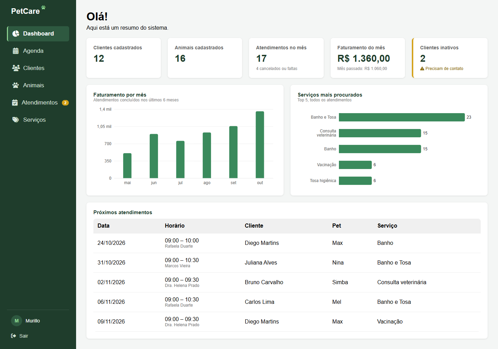
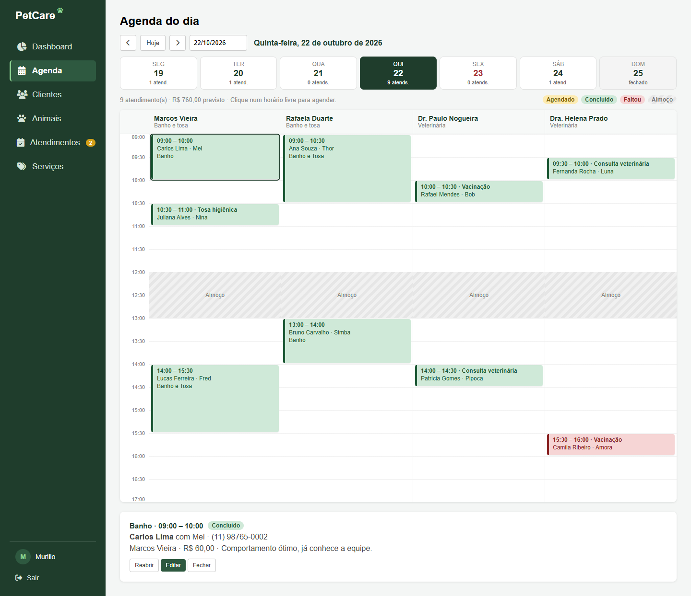
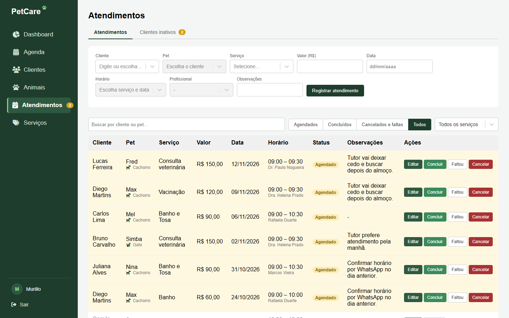
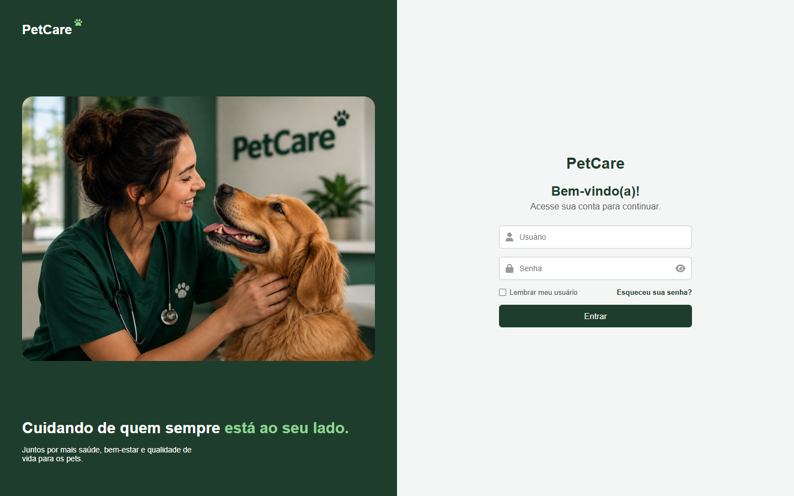
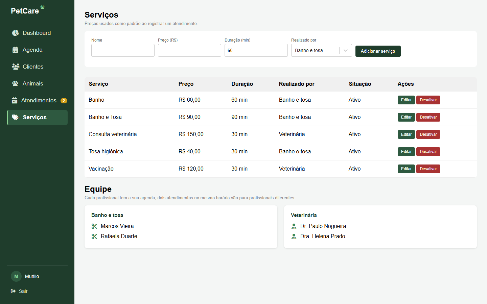

# PetCare

Projeto de portfólio: sistema de gestão para clínica veterinária e pet shop, com API REST em Node.js e painel administrativo em React.

## Sobre o projeto

O PetCare permite cadastrar clientes e seus animais, registrar e agendar atendimentos (banho, tosa, consultas, vacinas) e acompanhar o desempenho do negócio em um dashboard com indicadores e gráficos. O acesso é restrito por login com token JWT.

O projeto começou com o front-end em HTML, CSS e JavaScript puro e foi migrado para React, mantendo a mesma API.

## Telas

As imagens usam apenas dados fictícios, gerados pelo script `npm run dados-teste`.

**Dashboard**: indicadores, faturamento dos últimos 6 meses, serviços mais procurados e próximos atendimentos.



**Agenda do dia**: uma coluna por profissional, blocos do tamanho de cada serviço, cores por status, faixa da semana e pausa para almoço.



**Atendimentos**: formulário com sugestão automática de horário e profissional, filtros por status e serviço e ações rápidas.



<details>
<summary>Mais telas: login e catálogo de serviços</summary>





</details>

## Tecnologias

**Back-end**
- Node.js e Express
- PostgreSQL (driver `pg`)
- bcrypt (criptografia de senha)
- jsonwebtoken (autenticação JWT)
- dotenv
- Jest e Supertest (testes automatizados da API)

**Front-end**
- React
- Vite
- Recharts (gráficos)
- react-datepicker e date-fns (calendário em português)

## Funcionalidades

- Login com senha criptografada e token JWT (validade de 8 horas), com retorno automático ao login quando a sessão expira
- Rotas da API protegidas por middleware de autenticação
- Catálogo de serviços com preço; serviços usados no histórico são desativados em vez de excluídos
- Valor cobrado gravado em cada atendimento, para que reajustes de preço não alterem o faturamento passado
- CRUD de clientes e de animais
- Cadastro, edição e agendamento de atendimentos, vinculados ao cliente e ao pet atendido
- Agenda das 09:00 às 17:00 por profissional (2 tosadores e 2 veterinários): cada serviço tem uma duração e é feito por uma função; o sistema sugere o primeiro horário livre e o profissional menos ocupado, e a API recusa horários que se sobrepõem na agenda do mesmo profissional
- Status do atendimento (agendado, concluído, cancelado, faltou) com botões rápidos; cancelar libera o horário e o faturamento conta só os concluídos
- Agenda do dia em grade, com uma coluna por profissional: blocos do tamanho da duração de cada serviço, faixa da semana com a quantidade de atendimentos por dia, legenda de cores, linha da hora atual e clique num horário livre para agendar
- Pausa para almoço (12:00 às 13:00) e fechado aos domingos, validados no formulário e na API
- Lista de clientes inativos (sem atendimento há mais de 60 dias), com atalho para agendar
- Dashboard com:
  - indicadores de clientes, animais, atendimentos no mês, faturamento do mês e clientes inativos
  - gráfico de faturamento dos últimos 6 meses
  - gráfico dos serviços mais procurados
  - lista dos próximos atendimentos
- Busca sem distinção de acentos, filtros e paginação nas listas

## Estrutura do projeto

```
├── database/
│   ├── schema.sql          # Criação das tabelas
│   └── migrations/         # Alterações em bancos já existentes
├── docs/prints/            # Imagens das telas usadas neste README
├── frontend/               # Aplicação React (Vite)
│   └── src/
│       ├── api.js          # fetch com token JWT
│       ├── agenda.js       # Regras da agenda (horários livres, almoço, domingo)
│       ├── utils.js        # Busca, paginação, telefone e moeda
│       ├── hooks/          # Lógica reaproveitável (formulário de atendimento)
│       ├── pages/          # Login e Dashboard
│       └── components/     # Abas e componentes reutilizáveis
├── public/                 # CSS e imagens
├── src/                    # API Express
│   ├── config/             # Conexão com o banco
│   ├── controllers/
│   ├── middlewares/        # Autenticação
│   ├── routes/
│   ├── scripts/            # Utilitários de linha de comando
│   ├── app.js              # Monta o Express (usado pelo servidor e pelos testes)
│   └── server.js           # Abre a porta
└── tests/                  # Testes automatizados da API
```

## Testes

```
npm test
```

São 28 testes de integração (Jest e Supertest) que chamam a API de verdade e cobrem:

- autenticação: sem token, token falso, token vencido, cadastro e login;
- catálogo de serviços: cadastro e validações (preço, duração, função, nome repetido);
- regras da agenda: horário ocupado, mesmo horário com outro profissional, profissional de outra função, fora do expediente, almoço e domingo;
- status: cancelar libera o horário e reabrir um cancelado cujo horário foi ocupado é recusado;
- clientes inativos.

Os testes rodam em um schema separado do PostgreSQL (`testes_petcare`), recriado a partir do `database/schema.sql` a cada execução. Assim, eles nunca alteram os dados reais.

## Como rodar localmente

**Pré-requisitos:** Node.js 20 ou superior e PostgreSQL.

1. Clone o repositório e instale as dependências:

   ```
   git clone https://github.com/MurilloParanhos/petcare-api.git
   cd petcare-api
   npm install
   npm --prefix frontend install
   ```

2. Crie um banco no PostgreSQL e rode o arquivo `database/schema.sql` para criar as tabelas. Se o seu banco foi criado com uma versão anterior do projeto, rode os arquivos de `database/migrations/` em ordem.

3. Copie o `.env.example` para `.env` e preencha com os dados do seu banco e um `JWT_SECRET`.

4. Crie um usuário para acessar o sistema (não há tela de cadastro):

   ```
   curl -X POST http://localhost:3000/api/usuarios \
     -H "Content-Type: application/json" \
     -d '{"nome": "Admin", "email": "admin@exemplo.com", "senha": "suasenha"}'
   ```

   O servidor precisa estar rodando (passo 5).

5. Inicie o projeto:

   **Modo desenvolvimento** (com recarregamento automático), em dois terminais:

   ```
   npm start          # API em http://localhost:3000
   npm run front      # React em http://localhost:5173
   ```

   Acesse http://localhost:5173.

   **Modo produção:**

   ```
   npm run build
   npm start
   ```

   Acesse http://localhost:3000.

## Scripts úteis

| Comando | Descrição |
|---------|-----------|
| `npm start` | Inicia a API |
| `npm run front` | Inicia o React em modo desenvolvimento |
| `npm run build` | Gera a versão de produção do React em `frontend/dist` |
| `npm test` | Roda os testes automatizados da API |
| `npm run dados-teste -- criar` | Cria clientes, animais e atendimentos fictícios para popular o dashboard |
| `npm run dados-teste -- limpar` | Apaga somente os dados fictícios criados pelo comando acima |
| `npm run redefinir-senha -- email@exemplo.com` | Define uma nova senha para um usuário |

## Endpoints

Todas as rotas, exceto cadastro de usuário e login, exigem o cabeçalho `Authorization: Bearer <token>`.

| Método | Rota | Protegida | Descrição |
|--------|------|:---------:|-----------|
| POST | `/api/usuarios` | Não | Cadastra um usuário |
| POST | `/api/login` | Não | Faz login e retorna o token |
| GET | `/api/clientes` | Sim | Lista os clientes |
| POST | `/api/clientes` | Sim | Cadastra um cliente |
| PUT | `/api/clientes/:id` | Sim | Atualiza um cliente |
| DELETE | `/api/clientes/:id` | Sim | Exclui um cliente |
| GET | `/api/clientes/:id/animais` | Sim | Lista um cliente com seus animais |
| GET | `/api/animais` | Sim | Lista os animais (aceita `?cliente_id=`) |
| POST | `/api/animais` | Sim | Cadastra um animal |
| PUT | `/api/animais/:id` | Sim | Atualiza um animal |
| DELETE | `/api/animais/:id` | Sim | Exclui um animal |
| GET | `/api/atendimentos` | Sim | Lista os atendimentos |
| POST | `/api/atendimentos` | Sim | Registra um atendimento (o `animal_id` precisa ser do cliente; sem `valor`, usa o preço do serviço) |
| PUT | `/api/atendimentos/:id` | Sim | Atualiza um atendimento |
| PATCH | `/api/atendimentos/:id/status` | Sim | Muda só o status (agendado, concluido, cancelado, faltou) |
| GET | `/api/atendimentos/inativos` | Sim | Lista clientes sem atendimento há mais de 60 dias |
| GET | `/api/servicos` | Sim | Lista o catálogo de serviços |
| GET | `/api/profissionais` | Sim | Lista a equipe (tosadores e veterinários) |
| POST | `/api/servicos` | Sim | Cadastra um serviço |
| PUT | `/api/servicos/:id` | Sim | Atualiza nome, preço, duração ou ativa/desativa um serviço |
| GET | `/api/status` | Não | Verifica a conexão com o banco |

## Próximos passos

- Tela de cadastro e recuperação de senha
- Ficha do cliente com seus pets e histórico de atendimentos
- Filtros e paginação no back-end para grandes volumes de dados

## Autor

Murillo Paranhos Machado
[LinkedIn](https://linkedin.com/in/murillo-paranhos-machado-19889815a) · [GitHub](https://github.com/MurilloParanhos)
